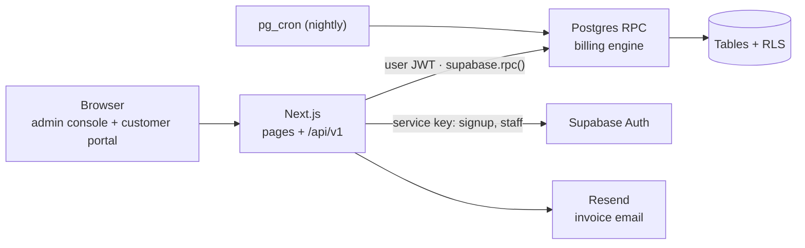

# Brightloop — Subscription Management System

One platform to run plans, subscriptions and recurring billing: products and plans → quotations → subscriptions → automatic invoices → payments → revenue reports. It also has a customer portal, so customers can manage their own subscriptions.

Built for the **Odoo hackathon** problem statement *"Subscription Management System"*.

> **Status:** the database layer (schema, billing engine, Row Level Security) is written and tested. The Next.js app is next. The full design (narration, architecture, schema, API contracts and build plan) is in [`docs/DESIGN.md`](docs/DESIGN.md).

---

## What it does

| Scene from the brief | What the system does |
| --- | --- |
| A new customer signs up | Email + password accounts (one per email), password rule of 9+ characters with upper, lower and a special character, and reset links by email. There are three roles: **Admin**, **Staff**, **Customer**. Only Admin can create staff. |
| Launching a new plan | Products (type, sales price, cost price, notes) with variants that add an extra price (e.g. Brand: Odoo **+560**). Plans have a price, a billing period (daily / weekly / monthly / yearly), a minimum quantity and availability dates. Each plan has its own flags: auto-close, closable, pausable, renewable. |
| Turning a quote into a subscription | Quotation templates with a plan, product lines and a validity period. Subscriptions are numbered (`SUB/2026/00042`) and move **Draft → Quotation → Confirmed → Active → Closed** (Paused is a side state), with a full status history. |
| Billing day | One click (or a nightly job) generates every due invoice with lines, taxes and totals filled in. Invoices move **Draft → Confirmed → Paid**. **Never billed twice, never skipped.** |
| A customer asks for a better price | Admin-only discount rules: fixed or %, minimum purchase or quantity, start/end dates, a usage limit, and a scope of products or subscriptions. They apply to the next invoice automatically and stop when they expire or run out. |
| The money comes in | Payments by method, amount, date and note, with partial payments supported. Paid, outstanding and overdue are visible at any time. |
| Month-end finance | A dashboard showing active subscriptions, MRR, revenue, outstanding and overdue amounts, with filters. Every page responds in under 2 s. |

## Tech stack

| Layer | Choice |
| --- | --- |
| Frontend | Next.js (App Router, TypeScript), Tailwind, shadcn/ui, TanStack Table |
| API | Next.js Route Handlers at `/api/v1/*`, zod validation |
| Auth | Supabase Auth (email + password, reset emails) |
| Database + business logic | Supabase Postgres: tables, Row Level Security, PL/pgSQL RPC functions |
| Scheduler | `pg_cron` runs `run_billing()` nightly |
| Email | Resend (also used as Supabase's custom SMTP) |
| Hosting | Vercel + Supabase |

**Design principle:** every money rule lives inside Postgres. The API only validates input and checks roles. Billing, discounts, taxes and payments run as database functions in a single transaction, behind RLS. So even a direct Supabase call with a customer's token cannot bill twice, edit a total, or read another customer's invoice.



## Repository layout

```
odoo/
├── README.md
├── docs/
│   └── DESIGN.md                    # narration, architecture, schema, API contracts, build plan
└── supabase/
    ├── migrations/
    │   ├── 0001_schema.sql          # 24 tables, 8 enums, constraints, indexes
    │   ├── 0002_functions.sql       # auth trigger, billing engine, RPCs, reports, views
    │   └── 0003_rls.sql             # Row Level Security policies + grants
    └── tests/
        ├── 00_local_postgres_stub.sql       # fakes Supabase's auth schema for plain Postgres
        ├── 10_billing_month_test.sql        # full billing month end to end
        └── 11_pause_resume_renew_test.sql   # pause, resume, renew, ownership checks
```

The Next.js app will live in `app/` (planned).

## Getting started

### 1. Create the database

1. Create a project at [supabase.com](https://supabase.com).
2. Open **SQL Editor** and run the three files in `supabase/migrations/` **in order**: `0001_schema.sql` → `0002_functions.sql` → `0003_rls.sql`.
3. **Database → Extensions** → enable `pg_cron`, then schedule the nightly billing run (00:30 UTC = 06:00 IST):

   ```sql
   select cron.schedule('nightly-billing', '30 0 * * *', $$ select public.run_billing(current_date) $$);
   ```

4. **Authentication → Sign In / Providers**:
   - Turn **off** "Allow new users to sign up". Signup goes through `POST /api/v1/auth/signup`, which enforces the password rule and then creates the user with the service key.
   - Set up **custom SMTP** (e.g. Resend). The built-in sender is rate-limited to a few emails an hour, which is not enough for a demo.

### 2. Create the first admin

Roles come from `app_metadata`, which only the service key can set. To create the very first admin:

1. **Authentication → Users → Add user** (email + password, auto-confirm).
2. In the SQL Editor:

   ```sql
   update auth.users set raw_app_meta_data = raw_app_meta_data || '{"role":"admin"}'
    where email = 'admin@brightloop.com';
   update public.profiles set role = 'admin'
    where email = 'admin@brightloop.com';
   ```

After that, the admin creates staff from the app (`POST /api/v1/admin/users`).

### 3. Environment variables

Create `.env.local` in the Next.js app:

```bash
NEXT_PUBLIC_SUPABASE_URL=https://<project-ref>.supabase.co
NEXT_PUBLIC_SUPABASE_ANON_KEY=<anon key>
SUPABASE_SERVICE_ROLE_KEY=<service role key>   # server only: signup + staff creation
RESEND_API_KEY=<resend key>
APP_URL=http://localhost:3000                  # used in reset and invoice email links
```

Never expose `SUPABASE_SERVICE_ROLE_KEY` to the browser, and never commit it.

### 4. Seed data for the demo

Seed at least 5,000 subscriptions so the speed claims are real. Then run `analyze;` before the first billing run: a big catch-up run on stale statistics slows down sharply.

## Running the database tests locally

The tests run on plain **PostgreSQL 16** with a small stub that imitates Supabase's `auth` schema and roles.

```bash
createdb brightloop_test
psql -d brightloop_test -v ON_ERROR_STOP=1 -f supabase/tests/00_local_postgres_stub.sql
psql -d brightloop_test -v ON_ERROR_STOP=1 -f supabase/migrations/0001_schema.sql
psql -d brightloop_test -v ON_ERROR_STOP=1 -f supabase/migrations/0002_functions.sql
psql -d brightloop_test -v ON_ERROR_STOP=1 -f supabase/migrations/0003_rls.sql
psql -d brightloop_test -f supabase/tests/10_billing_month_test.sql
psql -d brightloop_test -f supabase/tests/11_pause_resume_renew_test.sql
```

Notices starting with `OK` are expected (7 across both tests): they show RLS and the RPCs refusing forbidden actions. Any `BUG` notice is a failure. Run the tests on a fresh database each time (`dropdb brightloop_test` first), because they insert fixed ids.

### Results so far

| Check (5,000 subscriptions) | Result |
| --- | --- |
| Invoice math: 12 × CRM Seat (Odoo variant, 1,060) − 10% discount + 18% GST + 1,000 plan fee | **14,688.64** ✓ |
| Month-end dates (start 31 Jan) | 28 Feb → 31 Mar → 30 Apr, no drift ✓ |
| Discount with usage limit 2 | Applied twice, then stopped ✓ |
| Same billing run repeated | 0 new invoices ✓ |
| First run: 5,000 activations + 9,708 catch-up invoices | 7.1 s |
| Normal billing day: 1,942 invoices | 1.35 s |
| Dashboard summary | 18 ms |
| Revenue series (weekly, full year) | 6 ms |
| Overdue list, first page | < 1 ms |

## Key rules the database enforces

- **No double billing:** a partial unique index allows one live invoice per subscription period.
- **No skipped periods:** `run_billing(as_of)` loops until every due period is invoiced.
- **Safe concurrency:** rows are locked with `FOR UPDATE SKIP LOCKED`, so two billing runs never collide.
- **Discount usage** is reserved atomically per invoice and given back when the invoice is cancelled.
- **Overpayment is impossible:** `record_payment` locks the invoice and rejects amounts above the balance.
- **Money tables are write-protected:** app users have insert and update revoked on invoices, invoice lines and payments. Only the RPC functions write them.
- **No self-promotion:** a customer can't change their own role, and signup ignores any role sent from the browser.

## API at a glance

REST over JSON at `/api/v1`, 63 endpoints in 13 groups. Full request and response shapes are in [`docs/DESIGN.md`](docs/DESIGN.md#5-api-contracts).

| Group | Main endpoints |
| --- | --- |
| Auth | `POST /auth/signup` · `/auth/login` · `/auth/forgot-password` · `/auth/reset-password` · `GET /me` |
| Users (admin) | `GET/POST /admin/users` · `PATCH /admin/users/:id` |
| Catalog | `/products` (+ `/variants`) · `/plans` · `/taxes` · `/payment-terms` |
| Sales | `/quotation-templates` · `/subscriptions` · `POST /subscriptions/:id/transition` · `/renew` · `/invoice` |
| Billing | `POST /billing/run` · `GET /billing/runs` |
| Invoices | `/invoices` · `/confirm` · `/bulk-confirm` · `/cancel` · `/send` · `/print` |
| Payments | `POST /invoices/:id/payments` · `GET /payments` · `DELETE /payments/:id` |
| Discounts (admin) | `GET/POST /discounts` · `GET/PATCH /discounts/:id` |
| Reports | `GET /reports/summary` · `/reports/revenue` · `/reports/overdue` |

Errors always look like `{ "error": { "code": "INVALID_TRANSITION", "message": "...", "details": {} } }`, with status 400 / 401 / 403 / 404 / 409 / 500.

## Assumptions

- The plan price is a recurring **base fee** line, and product lines are billed on top of it.
- Prices are **tax-exclusive**, in a single currency (INR).
- Generated invoices start as **Draft**, and staff bulk-confirm them.
- **Overdue** is derived (confirmed, past due date, balance > 0), never stored.

