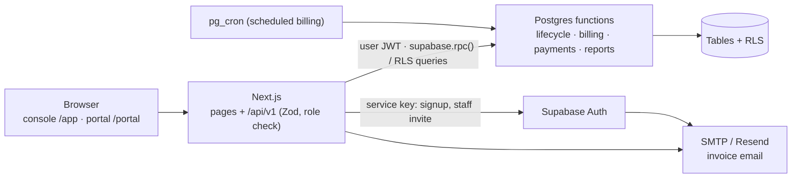

# SPEC: Brightloop Subscription Management System

Authority: `docs/problem-statement.md` → `context.md` (requirement IDs, decisions D-n) → this file → `docs/TASKS.md`. This file turns the decisions into concrete contracts. The code skeleton implements them: the Supabase migrations are the source of truth for the schema, `src/lib/validation` for the API shapes.

| Item | Decided here | Implemented in the skeleton |
| --- | --- | --- |
| 1. Problem, scope, demo path | §1 | — |
| 2. Schema | §2 entities, relations, conventions | `supabase/migrations/0001…` |
| 3. API contract | §3 endpoint table, error and response conventions | `src/lib/validation/*` (Zod) + `src/lib/api/handler.ts` |
| 4. Auth | §4 roles and the role × action matrix | login, session, role guard, RLS |
| 5. App shell | §5 screen list, nav per role | layouts, routing, route guards, API client |
| 6. Seed data | §6 what the demo data looks like | `scripts/seed.ts` + seed SQL |
| 7. Architecture | §7 stack, diagram, folders, owners | the scaffold |

---

## 1. Problem, scope, demo path

**Problem:** replace Brightloop's spreadsheets, hand-typed invoices, remembered renewals and manual reports with one system for the whole subscription life: catalogue → quotation → subscription → automatic invoices → payments → reporting, for admin, staff and customers (`context.md` §1–2).

**Scope:** every requirement ID in `context.md` §2 and decisions D-1…D-29. Should/Could/Out lists in `context.md` §7.

**Demo path (golden path, also the automated `npm run smoke` test):**
1. Admin creates a product with an Odoo variant (+560), a monthly plan, a tax and a discount rule.
2. Staff create a quotation from a template for a customer; Draft → Quotation → Confirmed → Active.
3. Billing run: due subscriptions get exactly one correct invoice each; a second run creates zero.
4. Invoice confirmed; two payments recorded; balance shown; then Paid.
5. Dashboard shows the movement (revenue, outstanding, overdue, active, MRR) with filters, under 2 s.
6. The customer logs in to the portal, sees only their own subscription and invoice; password reset by email.

---

## 2. Schema

### Conventions
- Postgres (Supabase). Tables `snake_case`, plural. Primary keys `uuid default gen_random_uuid()` (`billing_runs`, history: `bigint identity`).
- Money `numeric(12,2)`; rates `numeric(5,2)`; quantities `numeric(12,2)`. Never float.
- Business dates are `date` in Asia/Kolkata via `today_ist()`; timestamps `timestamptz` (UTC).
- Every foreign key declared; `on delete restrict` unless noted. Lookup data is archived with `is_active = false`, never deleted.
- Enums are Postgres enum types. Numbers: `SUB-000001`, `INV-000001` from sequences.
- Every table has Row Level Security on. Money tables are written only by SQL functions.

### Enums
| Enum | Values |
| --- | --- |
| `user_role` | admin, staff, customer |
| `product_type` | service, software, addon, other |
| `billing_period` | daily, weekly, monthly, yearly |
| `subscription_status` | draft, quotation, confirmed, active, closed |
| `pause_reason` | manual, out_of_term |
| `invoice_status` | draft, confirmed, paid, cancelled |
| `invoice_line_kind` | plan_fee, product |
| `discount_kind` | percent, fixed |
| `discount_scope` | products, subscription |
| `discount_condition` | none, min_purchase, min_quantity |
| `redemption_state` | reserved, committed, released |
| `payment_method` | cash, bank_transfer, card, upi, cheque |
| `billing_trigger` | manual, scheduled |
| `email_status` | sent, failed, skipped |

### Tables

**Identity**
| Table | Columns | Rules |
| --- | --- | --- |
| `profiles` | id (= `auth.users.id`), email citext, full_name, role, is_active, created_at | email unique; created by trigger on `auth.users`; role only from server-set `app_metadata` (D-27) |
| `customers` | id, user_id → profiles (nullable), name, company_name, email citext, phone, address, gstin, created_by, created_at | user_id unique; email unique (lowercase); linked to a login only after email verification (D-27) |

**Configuration**
| Table | Columns | Rules |
| --- | --- | --- |
| `taxes` | id, name, rate_percent, is_active | name unique; 0 ≤ rate ≤ 100 (D-4) |
| `payment_terms` | id, name, days, is_active | name unique; days ≥ 0 |
| `products` | id, name, type, sales_price, cost_price, notes, default_tax_id → taxes, is_active, created_at | prices ≥ 0 (CAT-1) |
| `product_variants` | id, product_id, attribute, value, extra_price | unique (product, attribute, value) (CAT-2) |
| `plans` | id, name, price, billing_period, min_quantity, available_from, available_to, auto_close, allow_early_close, allow_pause, allow_renew, tax_id → taxes, is_active | price ≥ 0; min_quantity ≥ 1; available_to ≥ available_from (CAT-3, CAT-4) |
| `quote_templates` | id, name, plan_id, validity_days, notes, is_active | validity_days > 0 (CAT-6) |
| `quote_template_lines` | id, template_id (cascade), product_id, variant_id, quantity, sort_order | quantity > 0 |
| `discount_rules` | id, name, kind, value, scope, condition, condition_value, starts_on, ends_on, usage_limit, used_count, is_active, created_by | value > 0; percent ≤ 100; condition_value required unless condition = none; ends_on ≥ starts_on; 0 ≤ used_count ≤ usage_limit (DISC-1) |
| `discount_rule_products` | rule_id (cascade), product_id | pk (rule, product); required when scope = products (DISC-2) |
| `app_settings` | key, value jsonb | `default_quote_validity_days` = 30, `scheduler_enabled` = false |

**Subscriptions**
| Table | Columns | Rules |
| --- | --- | --- |
| `subscriptions` | id, number, customer_id, plan_id, template_id, payment_term_id, status, start_date, expiry_date, quote_valid_until, is_paused, pause_reason, paused_on, billing_anchor, periods_billed, next_invoice_date, close_reason, notes, created_by, created_at, updated_at | number unique; expiry > start; pause_reason set iff is_paused; is_paused only when active; status, pause and billing columns change only through lifecycle functions, enforced by a trigger (SUB-2, SUB-3, D-6…D-10); period n starts at `add_period(billing_anchor, period, n)`, `periods_billed` counts invoiced periods since the anchor |
| `subscription_lines` | id, subscription_id (cascade), product_id, variant_id, description, quantity, unit_price, tax_id, sort_order | quantity > 0; unit_price ≥ 0 snapshotted when added = product price + variant extra unless overridden (D-5) |
| `subscription_status_history` | id, subscription_id, from_status, to_status, event, note, changed_by, changed_at | append-only; event ∈ transition, pause, resume, renew, out_of_term, auto_close, activate |

**Billing**
| Table | Columns | Rules |
| --- | --- | --- |
| `billing_runs` | id, as_of, trigger, triggered_by, started_at, finished_at, created_count, skipped_count, failed_count, failures jsonb | (D-18) |
| `invoices` | id, number, subscription_id, customer_id, billing_run_id, period_start, period_end, invoice_date, due_date, status, customer_snapshot jsonb, payment_term_name, payment_term_days, subtotal, discount_total, tax_total, total, amount_paid, amount_due (generated), discount_rule_id, discount_name, confirmed_at, sent_at, paid_at, cancelled_at, cancel_reason, created_at | number unique; **unique (subscription_id, period_start) where status ≠ cancelled** (BILL-4, D-17); 0 ≤ amount_paid ≤ total |
| `invoice_lines` | id, invoice_id (cascade), kind, product_id, variant_id, description, quantity, unit_price, amount, discount_amount, tax_name, tax_rate, tax_amount, total, sort_order | snapshot; written only by billing (D-1, D-3, D-5) |
| `discount_redemptions` | id, rule_id, invoice_id, amount, state, created_at | unique (rule_id, invoice_id) (D-23) |

**Finance and email**
| Table | Columns | Rules |
| --- | --- | --- |
| `payments` | id, invoice_id, customer_id, method, amount, paid_on, note, recorded_by, created_at | amount > 0; written only by `record_payment` (PAY-1, D-24) |
| `email_log` | id, to_email, subject, kind, related_id, status, error, created_at | (D-28) |

### Relations
Customer 1—0..1 Profile · Customer 1—n Subscription · Plan 1—n Subscription, QuoteTemplate · Subscription 1—n SubscriptionLine, Invoice, StatusHistory · Invoice 1—n InvoiceLine, Payment · BillingRun 1—n Invoice · DiscountRule 1—n DiscountRedemption n—1 Invoice · Product 1—n ProductVariant · Tax 1—n Product, Plan, SubscriptionLine.

### Required indexes
`subscriptions(status, next_invoice_date)`, `subscriptions(customer_id)`, `subscriptions(plan_id)`, `subscriptions(expiry_date)`, `invoices(status, due_date)`, `invoices(customer_id)`, `invoices(subscription_id)`, `invoices(invoice_date)`, `payments(invoice_id)`, `payments(paid_on)`, `discount_rules(is_active, starts_on, ends_on)`, `customers` trigram on name.

### Read views (security_invoker, so RLS applies)
- `subscription_list`: subscription + customer name + plan name/period + `recurring_amount` (plan fee + lines) + `mrr` + derived `quote_expired`, `days_to_expiry`, `is_out_of_term`.
- `invoice_list`: invoice + customer + subscription number + derived `is_overdue`, `days_overdue`, `payment_state` (unpaid / partially_paid / paid).

### SQL function contracts (owner slice in brackets)
| Function | Does | Who may call |
| --- | --- | --- |
| `today_ist()`, `add_period(anchor, period, n)` | Asia/Kolkata date; calendar-aware period start with month-end clamp [Core] | all |
| `app_role()`, `is_internal()`, `is_admin()`, `my_customer_id()` | helpers for RLS [Core] | all |
| `create_subscription_from_template(template, customer, start, expiry, term)` | Draft with lines snapshotted [S2] | staff, admin |
| `sub_transition(id, to, note)` | the D-7 state machine, writes history [S2] | staff, admin; customer only Quotation→Confirmed if enabled (Could) |
| `sub_set_lines(id, lines jsonb)` | replace lines; D-2 check when Active [S2] | staff, admin |
| `sub_pause(id, note)` / `sub_resume(id)` / `sub_renew(id)` / `sub_close(id, reason)` | D-8, D-9, D-10, close rules [S2] | staff, admin, owning customer when the plan allows |
| `sub_allowed_actions(id)` | the actions the caller may take now, returned as `allowed_actions` [S2] | anyone who can see the subscription |
| `process_lifecycle(as_of)` | activate Confirmed with start ≤ as_of; auto-close or mark out-of-term at expiry [S2] | billing run |
| `run_billing(as_of, trigger)` | advisory lock → `process_lifecycle` → bill every due subscription under its own savepoint → BillingRun row [S3] | staff, admin, cron |
| `preview_billing(as_of)` | what a run would create, no writes (Should) [S3] | staff, admin |
| `invoice_confirm(id)`, `invoice_confirm_many(ids)` | Draft → Confirmed; commits redemption; total 0 → Paid [S3] | staff, admin |
| `invoice_cancel(id, reason)` | no payments only; releases redemption [S3] | staff, admin |
| `invoice_mark_sent(id)` | sets `sent_at` after the email is logged as sent [S3] | staff, admin |
| `record_payment(invoice, amount, method, paid_on, note)` | D-24, sets Paid at zero balance [S4] | staff, admin |
| `report_summary(from, to, plan, customer)`, `report_revenue(from, to, bucket)`, `report_overdue()`, `report_renewals(days)` | D-25 [S4] | staff, admin |

Internal (not callable from the API): `bill_next_period`, `run_billing_core`, `sub_log`, `sub_load`, `sub_check_min_quantity`, `enter_lifecycle`, the `seed_*` functions (service role only). Every slice file ends by revoking EXECUTE from `anon` and granting only what the API calls.

---

## 3. API contract

### Conventions
- Base `/api/v1`, JSON. Auth = Supabase session cookie (browser) or `Authorization: Bearer <access_token>`.
- Request bodies and query strings are validated with the shared Zod schemas in `src/lib/validation`; the same schemas validate forms in the browser.
- Lists: `?page=1&page_size=20&sort=-created_at&q=...` → `{ data, page, page_size, total }`; page_size max 100.
- Money in responses is a JSON number with 2 decimals (INR); dates `YYYY-MM-DD`; timestamps ISO 8601.
- Errors, always: `{ "error": { "code": "QUOTATION_EXPIRED", "message": "…", "details": {} } }`

| HTTP | Codes |
| --- | --- |
| 400 | `VALIDATION_ERROR` (details = field → messages) |
| 401 | `UNAUTHENTICATED` |
| 403 | `FORBIDDEN` |
| 404 | `NOT_FOUND` (also for another customer's record) |
| 409 | business rules: `EMAIL_TAKEN`, `INVALID_TRANSITION`, `QUOTATION_EXPIRED`, `BELOW_MIN_QUANTITY`, `PLAN_NOT_AVAILABLE`, `PLAN_NOT_PAUSABLE`, `PLAN_NOT_CLOSABLE`, `PLAN_NOT_RENEWABLE`, `OUT_OF_TERM_RENEW_REQUIRED`, `NOT_EDITABLE`, `ALREADY_BILLED`, `BILLING_RUN_IN_PROGRESS`, `INVOICE_NOT_CONFIRMED`, `AMOUNT_EXCEEDS_DUE`, `CANNOT_CANCEL`, `IN_USE` |
| 500 | `INTERNAL` |

Postgres functions raise `CODE: detail` with SQLSTATE P0001; the handler turns that into the 409 code.

### Endpoints (owner slice · roles: A admin, S staff, C customer-own)
| Method | Path | Roles | Purpose | IDs |
| --- | --- | --- | --- | --- |
| POST | `/auth/signup` | public | create customer account (AUTH-2 checked) | AUTH-1, AUTH-2 |
| POST | `/auth/login`, `/auth/logout` | public | session | AUTH-4 |
| POST | `/auth/forgot-password` | public | Supabase reset email; same answer whether or not the email exists | AUTH-3 |
| POST | `/auth/reset-password` | recovery session | set new password (AUTH-2 checked) | AUTH-3 |
| GET | `/me` | any | profile, role, customer_id | AUTH-4 |
| **S1** GET, POST | `/products` | read A S C; write A | list; create with variants | CAT-1, CAT-2 |
| GET, PATCH | `/products/:id` | read A S C; write A | view; edit; archive (`is_active`) | CAT-1 |
| POST, PATCH, DELETE | `/products/:id/variants[/:vid]` | A | variants | CAT-2 |
| GET, POST · GET, PATCH | `/plans` · `/plans/:id` | read A S C; write A | plans incl. switches | CAT-3, CAT-4 |
| GET, POST · PATCH | `/taxes` · `/taxes/:id` | read A S; write A | tax rules | CAT-5, BILL-2 |
| GET, POST · PATCH | `/payment-terms` · `/payment-terms/:id` | read A S; write A | payment terms | SUB-2 |
| GET, POST · GET, PATCH | `/quote-templates` · `/quote-templates/:id` | read A S; write A | templates with lines | CAT-6 |
| GET, POST · GET, PATCH | `/discount-rules` · `/discount-rules/:id` | read A S; write A | discount rules, with used/limit | DISC-1, DISC-2 |
| **S2** GET, POST · PATCH | `/admin/users` · `/admin/users/:id` | A | add staff (invite email), role, deactivate | AUTH-5 |
| GET, POST · GET, PATCH | `/customers` · `/customers/:id` | A S; C own (GET, PATCH profile fields) | customer records | SUB-2, PORTAL-1 |
| GET | `/subscriptions` | A S; C own (never Draft) | list: status, plan, customer, q, flags | SUB-3, PORTAL-1 |
| POST | `/subscriptions` | A S | blank or `from_template_id` | SUB-1, SUB-2 |
| GET, PATCH | `/subscriptions/:id` | A S; C own GET | detail incl. lines, history, invoices, `allowed_actions`; edit header in Draft/Quotation | SUB-2, SUB-3 |
| PUT | `/subscriptions/:id/lines` | A S | replace lines | SUB-2, D-13 |
| POST | `/subscriptions/:id/transition` | A S | `{ to, note }` | SUB-3 |
| POST | `/subscriptions/:id/pause` · `/resume` · `/renew` · `/close` | A S; C own if plan allows | D-8…D-10 | CAT-4, PORTAL-1 |
| **S3** POST | `/billing/run` | A S | `{ as_of? }` → BillingRun summary | BILL-1, BILL-4 |
| GET | `/billing/runs`, `/billing/preview?as_of=` | A S | history; dry run (Should) | BILL-4 |
| GET | `/invoices` | A S; C own (never Draft) | list: status, overdue, customer, subscription, dates, q | BILL-3, PAY-2 |
| GET | `/invoices/:id` | A S; C own | detail with lines, discount, taxes, payments | BILL-1 |
| POST | `/invoices/:id/confirm`, `/invoices/confirm` (bulk) | A S | Draft → Confirmed | BILL-3 |
| POST | `/invoices/:id/cancel` | A S | `{ reason }` | BILL-3 |
| POST | `/invoices/:id/send` | A S | email to customer; returns the email_log status | BILL-3 |
| page | `/print/invoices/:id` | A S; C own | printable invoice | BILL-3 |
| **S4** POST | `/invoices/:id/payments` | A S | record payment | PAY-1 |
| GET | `/payments` | A S; C own | list: dates, method, customer | PAY-1 |
| GET | `/reports/summary?from&to&plan_id&customer_id` | A S | KPI cards incl. MRR | REP-1, REP-2 |
| GET | `/reports/revenue?from&to&bucket` | A S | revenue received vs invoiced series | REP-1 |
| GET | `/reports/overdue?bucket&page` | A S | overdue invoices by age bucket | PAY-2, REP-1 |
| GET | `/reports/renewals?days=30` | A S | expiring soon + out of term (Should) | D-9 |

Key shapes are the Zod schemas; response types live in `src/lib/types.ts`. `GET /subscriptions/:id` returns `allowed_actions` (the transitions and pause/resume/renew/close the caller may do now) so screens never duplicate the rules.

---

## 4. Auth

- Supabase Auth (D-26): sign-up via our API (password rule), login, session cookie refreshed by middleware, reset email from Supabase via our SMTP.
- Role lives in `profiles.role`, set from `app_metadata` (server-only). A new signup is always `customer`. Staff are created only by an admin (AUTH-5).
- Three guards: the route guard in layouts (`/app` = admin, staff; `/portal` = customer), the API role check in every handler, and Row Level Security in Postgres.

### Role × action matrix
See `context.md` §5; the endpoint table above lists the same roles per endpoint. Tests in `scripts/smoke.ts` cover at least one allow and one deny per AUTH/BILL/PAY area.

---

## 5. App shell

### Screens and nav
**Admin / staff console `/app`** (admin-only items marked ●)
| Nav | Route | Slice |
| --- | --- | --- |
| Dashboard | `/app` | S4 |
| Subscriptions | `/app/subscriptions`, `/new`, `/[id]` | S2 |
| Customers | `/app/customers`, `/[id]` | S2 |
| Invoices | `/app/invoices`, `/[id]` | S3 |
| Billing runs | `/app/billing` | S3 |
| Payments | `/app/payments` | S4 |
| Products | `/app/products`, `/[id]` | S1 |
| Plans | `/app/plans`, `/[id]` | S1 |
| Quotation templates | `/app/templates`, `/[id]` | S1 |
| Discount rules | `/app/discounts`, `/[id]` | S1 |
| Taxes & payment terms | `/app/settings` | S1 |
| Users ● | `/app/users` | S2 |

**Customer portal `/portal`** (S2): My subscriptions `/portal`, subscription detail `/portal/subscriptions/[id]` (pause / resume / renew / close per plan), My invoices `/portal/invoices`, invoice detail `/portal/invoices/[id]`, Profile `/portal/profile`.

**Public:** `/login`, `/signup`, `/forgot-password`, `/reset-password`, `/auth/callback` (Core). **Print:** `/print/invoices/[id]` (S3).

Every list: server pagination, search, filters, empty / loading / error states, status badges.

---

## 6. Seed data

Deterministic (`setseed`), loaded by `npm run seed` with the service key; the scheduler stays off.

| Data | Amount and shape |
| --- | --- |
| Logins | 1 admin, 2 staff, 1 demo customer (credentials in README) |
| Customers | ~1,500, some without a login |
| Taxes (demo) | GST 18% (demo), GST 12% (demo), GST 5% (demo) |
| Payment terms | Immediate (0), Net 15, Net 30 |
| Products | ≥ 8, types service/software/addon/other; one with Brand variants (Odoo +560, Generic +0); at least 2 add-ons |
| Plans | each billing period; switch combinations: auto-close, early close, pause, renew on/off; one ending soon |
| Templates | ≥ 3 |
| Discount rules | 10% from 10 seats (min quantity); fixed ₹500 off from ₹5,000 (min purchase); one with usage limit 3; one expiring within days |
| Subscriptions | ≥ 5,000 across Draft, Quotation (some expired), Confirmed, Active (incl. paused and out-of-term), Closed; **~300 due today** |
| Invoices | ≥ 20,000 past invoices: paid, partially paid, outstanding, overdue, a few cancelled; payments consistent with them |

---

## 7. Architecture

### Stack
Next.js 15 (App Router, TypeScript) · Tailwind 4 · SWR · Zod · Supabase (Postgres, Auth, `pg_cron`) · Resend/SMTP · Vercel.



### Folder layout and owners
```
supabase/migrations/
  0001_core_schema.sql          Core   tables, enums, constraints, indexes
  0002_core_security.sql        Core   helpers, RLS, grants, profile trigger
  0003_core_views.sql           Core   subscription_list, invoice_list
  0100_s1_catalog.sql           S1     (only if S1 needs SQL)
  0200_s2_lifecycle.sql         S2     subscription functions
  0300_s3_billing.sql           S3     billing engine, invoice functions
  0400_s4_finance.sql           S4     payments, reports
  0900_seed_helpers.sql         Core   seed functions (service role only)
supabase/tests/                 Core   local Postgres stub + business and security checks
src/
  app/(auth)/                   Core   login, signup, forgot, reset
  app/app/layout.tsx            Core   console shell + guard
  app/portal/layout.tsx         Core   portal shell + guard
  app/app/{products,plans,templates,discounts,settings}/   S1
  app/app/{subscriptions,customers,users}/, app/portal/**  S2
  app/app/{invoices,billing}/, app/print/**                 S3
  app/app/page.tsx (dashboard), app/app/payments/          S4
  app/api/v1/{products,plans,taxes,payment-terms,quote-templates,discount-rules}/   S1
  app/api/v1/{admin,customers,subscriptions}/                                       S2
  app/api/v1/{billing,invoices}/ (except payments)                                  S3
  app/api/v1/{payments,reports}/, invoices/[id]/payments                            S4
  app/api/v1/{auth,me}/                                                             Core
  components/ui/, components/shell/        Core
  components/s1 … s4/                      each slice
  lib/                                      Core (validation: each slice adds its own file)
scripts/seed.ts, scripts/smoke.ts           Core (lead)
```
